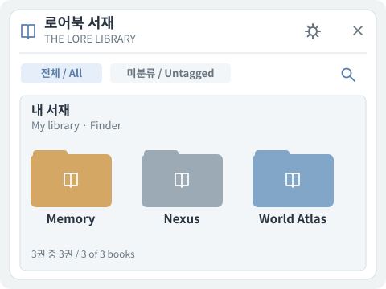
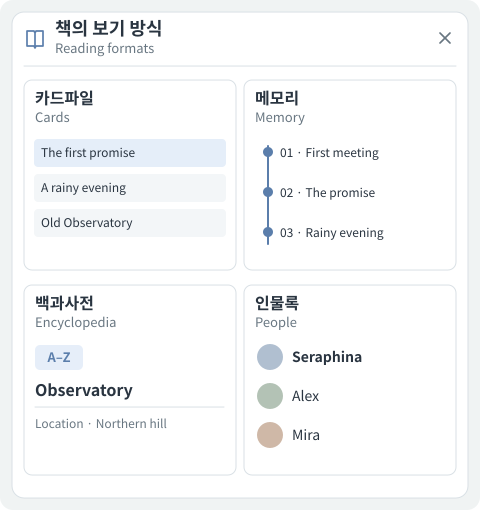
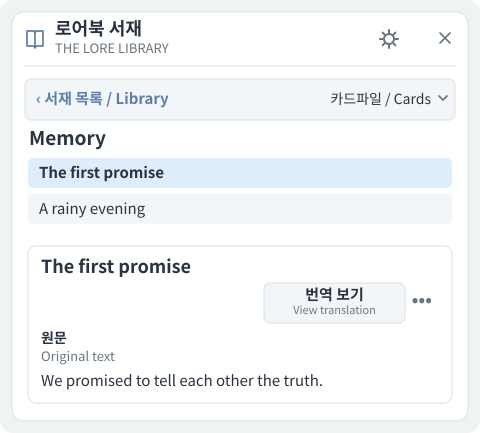
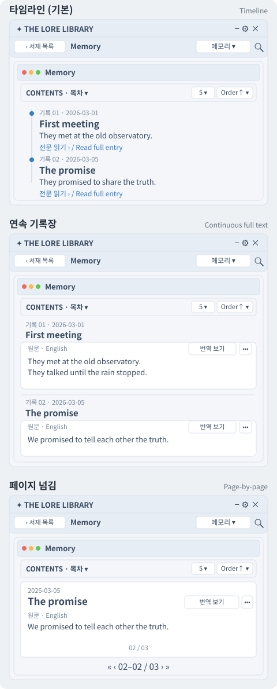
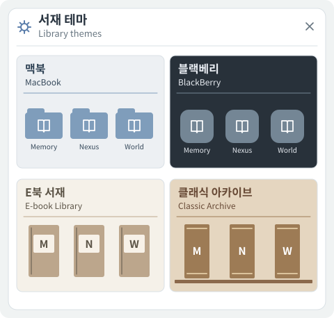
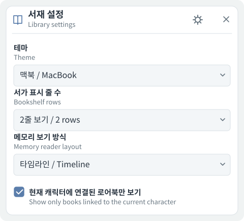
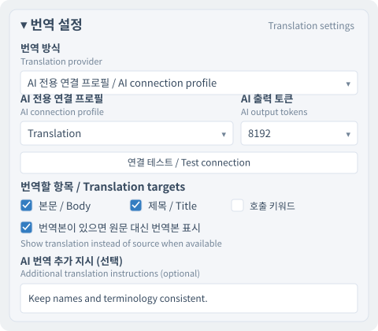
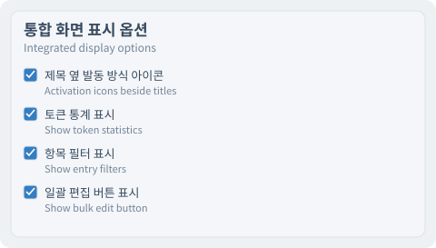

# 🦦 Sloth the Lorebook Manager

A fork of **[Lorebook Manager (로어북 매니저)](https://github.com/foreverharibo-boop/lore-manager)** for SillyTavern, made with the original author's permission.

The original extension provides the foundation for lorebook editing, translation, token statistics and backups. This fork retains that foundation and adds an independent reading library, alternative display modes and changes suited to my own resource-constrained setup.

**Current version:** 1.4.85-ambasa.92 · Based on upstream 1.4.85

[한국어 안내 ↓](#-로어북-매니저-나무늘보씨) · [Original project](https://github.com/foreverharibo-boop/lore-manager) · [Upstream documentation](docs/UPSTREAM_README.md) · [Fork development notes](AMBASA_FORK_NOTES.md)


**One extension, two ways to use it.** Keep SillyTavern's native editor if you only want the independent library. Use the integrated editor if you also want the original batch-editing and translation tools.

## Installation

1. Back up your SillyTavern data, settings and translations, particularly when switching from the original.
2. Open SillyTavern's extension installer and enter:
   <code>https://github.com/AmbasaS2/lore-manager</code>
3. Reload SillyTavern. Open **Extensions → 로어북 매니저** to configure the extension or use the **로어북 매니저 (Lorebook Manager)** item in the extension menu to open the library.

> [!IMPORTANT]
> Do not run the original and this fork together. When switching versions, preserve your data and replace only the extension code. Do not use data reset or uninstall to migrate.

- Based on SillyTavern 1.18. Other versions and extension combinations may behave differently.
- The extension follows SillyTavern's interface language automatically. Korean is unchanged; English, Japanese, Simplified Chinese, Traditional Chinese, and Spanish are available for the main settings, library, and editor controls. Some secondary messages use English fallback.

## Who is this for?

- Read existing lorebooks in an independent library without the native editor's many settings, or keep the integrated/Foldy editing view.
- Find books and entries by character, tags, favorites, original or saved translated title, keyword and body text; use covers, reference images and Resume Reading.
- Choose four reading formats and four library themes independently, and move, resize or minimize the library.
- Translate body, title and trigger keywords, edit original and translation separately, and translate multiple books or bulk-edit selected activation fields.
- Inspect total, constant, selective and vectorized token statistics and filter entries by activation type in the integrated editor.
- Create manual or automatic backups, restore into an existing or new lorebook, and export selected or all original books as ZIP.
- Prefer an independent reader on a constrained device or server, without promising a universal speed improvement.

The original editing, translation, token and backup tools are still available. If upstream works well for you, you do not have to switch.

## ⚡ Quick start

**Current version: 1.4.85-ambasa.92.**

> **Open your library → choose a book → read.**
>
> Keep your existing lorebooks and activation rules. The integrated editor is still available for translation, batch editing and backups.

**Set up once**

1. Install the fork without resetting data, then reload.
2. Extensions settings → 로어북 매니저 → choose the native display mode if you only want the independent reader.

**Everyday reading (no AI setup needed)**

1. Extensions menu → **로어북 매니저 (Lorebook Manager)** → select a book.
2. Choose a reading format and theme.
3. To search: magnifier → term → Enter or the same magnifier. In-book search stays within the book. Saved translations are searchable without an AI request.
4. Read the original or saved translation. The **…** menu offers edit, translate and native editor navigation.

Configure a translation provider only if you need new translations.

## 📖 How to use

> The bilingual illustrations are simplified UI mock-ups based on the extension controls in SillyTavern, not screenshots. Values and lorebooks are illustrative examples.

Open **Extensions → 로어북 매니저**. If you only want to read, choose the native editor in Display / advanced and open the library. Configure translation only for new translations, and backup options as needed.

### 1. Choose a display mode

Under **화면·고급 설정**, select the display mode that suits your setup.

| Display mode | When to use it |
| --- | --- |
| **실리태번 기본 화면** (Native) | Keep World Info as it is and open the separate library when needed |
| **로어북 매니저 통합 화면** (Integrated) | Use the editing tools inherited from the original |
| **Foldy 연동 화면** (Foldy integration) | When Foldy is installed |

The independent library can be opened with any of these choices.

### 2. The Lore Library

Open the library from the extension menu or the settings panel. Search and filter books by tags or show books linked to the current character. If no linked books are found, the linked-only view falls back to all books.

<p align="left"></p>

#### Find and organize your books

- **Tags:** filter the shelf.
- **Favorites:** use the book tag panel to pin favorite books first.
- **Character filter:** show linked books; falls back to all books if none are linked.
- **Resume Reading:** open the last record from the shelf settings.

#### Search your library

1. Tap the shelf magnifier to reveal the input field on its left.
2. Type a search term.
3. Press Enter or the same magnifier to submit.

| Search location | Scope |
| --- | --- |
| Shelf | Book names and original/saved translated titles, keywords and body text (up to 100 entry results) |
| Inside a book | That book only |

Typing alone does not search. Click outside or press Escape to close the field. No AI request is needed.

> [!TIP]
> If a native-editor jump cannot find an entry, clear its current search/filter. Jumps respect the editor's sort and filters; Foldy retains its own page navigation.

Choose a reading format for each book:

<p align="left"></p>

| Format | Good for |
| --- | --- |
| 🗂️ **Card file (카드파일)** | General settings, rules and individual records |
| 📕 **Memory (메모리)** | Chronological RP memories: timeline, full-text journal or page turning |
| 🌍 **Encyclopedia (백과사전)** | Worldbuilding, locations and background |
| 👥 **Character directory (인물록)** | Character profiles and relationships |

These are presentation formats, not new SillyTavern lorebook types. Changing the format, tag or cover does not change World Info injection settings or create memories.

### 3. Read and edit records

<p align="left"></p>

#### Read or edit an entry

- Select a book and entry; switch between original and available translation.
- Open **…** to edit, translate, open the corresponding World Info entry or attach a reference image.
- Edit translations separately from original records.
- Use covers and tags to organize the library.

#### Contents and sorting

- Display 5 / 10 / 20 entries per page.
- Use navigation buttons or click the page number to jump.
- **Order↑ / Order↓:** numerical World Info Order. Missing/non-numeric values come after numeric values in ascending order; descending reverses the list.
- **Title:** sort by title.
- Collapse the contents list in Memory, Encyclopedia and Character Directory.

Reading order does not change the lorebook or its injection settings.

#### 📕 Memory reading modes

<p align="left"></p>

Open the library gear icon → **Memory reading mode**.

| Mode | What you see |
| --- | --- |
| **Timeline (default)** | Opening excerpt of the actual entry (up to 100 Unicode characters); expand to continue reading in place |
| **Continuous full text** | Complete records in sequence |
| **Original page reader** | Page-by-page reading |

- Timeline and continuous modes place count and sort controls beside the TOC. Load more in batches of 5 / 10 / 20.
- Expand or collapse the same text directly in Timeline without changing its starting position, saved preference or text size. Result remains at the end; reading tools follow the body. Changing pages or reading modes folds the records.
- TOC and search still jump to individual records.
- No new AI request is made.

The optional WorldInfo Info integration uses the book/entry UID bridge to open an exact record.

### 4. Themes and window settings

<p align="left"></p>

Choose from **MacBook, BlackBerry, E-book Library and Classic Archive**. Each theme has layouts for the four reading formats.

<p align="left"></p>

#### Window and appearance controls

| Control | Action |
| --- | --- |
| Header | Drag to move |
| Corner | Drag to resize |
| Minimize | Return to the small launcher |
| Close | Close the library |
| Gear | Theme, shelf rows (1–3), memory reading mode and character-linked filter |

The settings illustration predates the memory reading mode added in .79.

**Window position and size**

- Wide and narrow screens keep separate window dimensions and last dragged positions (760 px layout-width threshold for position).
- Reopening restores the saved position within the visible screen.
- Automatic viewport and keyboard adjustments do not overwrite it.

### 5. Translation and integrated editing

#### Translation setup

<p align="left"></p>

1. Open **번역 설정 (Translation)**.
2. Choose a separate AI connection profile or Google translation.
3. Choose the content to translate: body, title, keywords.
4. Decide whether to display translations instead of originals.

AI revision and keyword recommendations require an AI profile even with Google translation. Translated titles and keywords are reading aids; the actual trigger keywords do not change.

**Automatic translation and original-text reflection are separate options.**

Only enable automatic reflection if you really want edited translations to change the original text. It is off by default for new installations; existing preferences are preserved. Before an existing nonempty original is fully replaced by reverse translation, a browser-local safety backup is required even if routine automatic backup is off.

#### Translate multiple books

- Open **로어북 일괄 번역**.
- Select one or more books.
- Translate missing entries or retranslate all selected entries.
- Cancel a running job if necessary.

Eligible short entries can be grouped for AI translation. Successful fields are saved even if another field fails; failed fields keep their existing translations. Long bodies are split within a conservative character budget while protecting code and macros. Request counts, time and cost depend on provider and content.

### Integrated editing: statistics and filters

<p align="left"></p>

Extensions → 로어북 매니저 → 화면·고급 설정 → 통합 화면 표시 옵션.

- **Activation icons:** show entry activation type.
- **Token statistics:** total, constant, selective and vectorized tokens, plus entry count.
- **Filters:** all / constant / keyword / vector.
- **Bulk edit:** tools for selected entries.

PC and mobile share these controls. This is book/editor statistics, not the actual injected-token total for the latest reply.

### Backup and restore controls

Open **로어북 백업 (Backup)** in extension settings.

- **Manual backup:** save the selected book.
- **Automatic backup:** optionally save on open/edit.
- **Import/export:** move browser backup JSON.
- **Restore:** restore into the current book (with a safety backup first), or into a new book.
- **Individual snapshots:** export or delete a stored backup.
- **Original JSON ZIP:** export selected/all original books separately.

> [!CAUTION]
> Data reset can remove saved translations, local backups or all extension settings/cache without deleting original books. Back up first; do not use reset to migrate.

### 6. Storage, backup and performance

#### What is stored where?

| Data | Storage |
| --- | --- |
| Original lorebooks | Remain in SillyTavern |
| Library categories, tags and image associations | Display metadata |
| Translations and per-entry language settings | Server-side JSON in `/user/files/` |
| Preferences and translation storage references | Extension settings |
| Browser backups | Browser-local, up to 20 across books; automatic backup off by default |
| Original JSON exports | Selected/all books as ZIP, separate from translation backups |

#### Back up the separate translation files

```text
<SillyTavern data root>/<user handle>/user/files/
data/default-user/user/files/ (usual default)
```

- Per-book file: `lore-manager-translation-<book-slug>-<hash>.json`
- Index: `lore-manager-translation-index-v1.json`
- Legacy settings archives and recovery files, when present

Back up these files with settings and original lorebooks when moving servers. Existing translations are archived and verified before migration out of `settings.json`; the separate files avoid serializing all translations every time settings are saved.

#### How the fork reduces repeated work

- Reuses eligible recently visited native pages (up to two).
- Avoids some repeated layout and translation lookups.
- Loads selected books on demand in the independent library and paginates lists.

These choices address my usage pattern, not every device or server. Some work happens in the browser. Desktop and mobile-width layouts were checked in isolated Chromium tests; compatibility with all real devices or extensions is not established.

### 7. Reference — Optional extension settings

| Settings section | Controls |
| --- | --- |
| 번역 설정 (Translation) | AI profile or Google, AI output tokens, connection test, body/title/keyword selection, translation-first display, AI instructions, automatic translation, automatic original-text reflection |
| 화면 · 고급 설정 (Display / advanced) | Native, integrated or Foldy; open independent library and filter by selected character |
| 통합 화면 표시 옵션 (Integrated editor display) | Activation icons, token statistics, filters, bulk-edit toolbar |
| 로어북 백업 (Backup) | Automatic/manual browser backups, import/export backups, selected/all original JSON ZIP |
| 데이터 관리 (Data management) | Reset translations, backups or extension data; back up first, never use reset to migrate |

**Just want to read?** Keep native World Info and open the library from the extension menu. To translate lore, choose a provider and body translation; leave automatic original-text reflection off unless you intend to change the source.

During RP: library → choose a book and entry → read original or translation → edit only if needed. Choose theme, rows, memory reading mode and linked-character filter from the library gear; set each book's category inside the book.

## Troubleshooting

- **Search does nothing:** press Enter or the same magnifier after typing.
- **Entry jump cannot find its row:** clear native-editor search/filter.
- **Reading only:** use native display mode and the independent library.
- **Switching versions:** back up original books and separate translation JSON files; do not reset data.

## 🧩 Works well with

> The library works without AI, STLO, or Memory Books. Memory Books memories and other existing lorebooks can be displayed in any reading format. With compatible WorldInfo Info and its optional library link, the exact entry opens by book name and UID. STLO's injection order is independent of library reading order.

[Lorebook Ordering for Sloths](https://github.com/AmbasaS2/SillyTavern-LorebookOrdering) · [Sloth's Memory Books / 게으름뱅이의 메모리북](https://github.com/AmbasaS2/SillyTavern-MemoryBooks) · [WorldInfo Info of Sloth / 게으름뱅이가 읽는 월드인포인포](https://github.com/AmbasaS2/SillyTavern-WorldInfoInfo)

The detailed sections below explain optional settings. Compatibility is version-dependent; it does not guarantee every third-party extension or device.

## Credits and license

Original project: **로어북 매니저 / Lorebook Manager**  
Original author and copyright: see the preserved [NOTICE](NOTICE).  
Original source: [Lorebook Manager](https://github.com/foreverharibo-boop/lore-manager)

This fork is maintained by AmbasaS2 with the original author's permission. Thank you to the original author for sharing the extension and allowing me to adapt it.

Licensed under **AGPL-3.0-only**. See [LICENSE](LICENSE) and [NOTICE](NOTICE). The original README is preserved in [docs/UPSTREAM_README.md](docs/UPSTREAM_README.md), and changes to this fork are recorded in [AMBASA_FORK_NOTES.md](AMBASA_FORK_NOTES.md). The original author's request to keep public forks accessible is a voluntary request; applicable AGPL obligations remain unchanged.

---

<a id="-로어북-매니저"></a>

# 🦦 로어북 매니저: 게으름뱅이

**화면 언어:** 실리태번 화면 언어를 자동으로 따릅니다. 주요 설정·서재·편집 조작은 한국어·영어·일본어·중국어 간체/번체·스페인어로 표시되며 일부 안내는 영어로 대체됩니다. 원본 로어와 번역 기록은 변경하지 않습니다.


원작자님의 허락을 받아 **[로어북 매니저](https://github.com/foreverharibo-boop/lore-manager)** 를 제 사용 환경에 맞춰 수정한 포크입니다. 원작의 편집·번역·토큰 계산·백업 기능을 기반으로 독립 서재와 표시 방식, 번역 저장 구조 등을 추가하고 조정했습니다.

**현재 버전:** 1.4.85-ambasa.92 (원작 1.4.85 기반)


**서재에서 읽고, 월드 인포에서 설정하세요.** 서재는 따로 열 수 있으므로 기본 월드 인포를 그대로 사용해도 됩니다. 번역과 일괄 편집까지 필요하면 통합 화면을 선택하세요.

## 설치

1. 기존 로어북과 번역 기록, SillyTavern 설정을 백업합니다.
2. 확장 설치 메뉴에 <code>https://github.com/AmbasaS2/lore-manager</code> 를 입력합니다.
3. 새로고침한 뒤 확장 탭의 **로어북 매니저**에서 설정하거나, 확장 메뉴에서 **로어북 매니저**를 눌러 독립 서재를 엽니다.

> [!IMPORTANT]
> 원작과 이 포크를 동시에 실행하지 마세요. 기존 설치에서 전환할 때는 데이터를 유지하고 확장 코드만 교체합니다. 삭제·전체 초기화를 전환 방법으로 사용하지 마세요.

SillyTavern 1.18 기반입니다. 다른 버전 및 확장 조합에서는 동작이 다를 수 있습니다.

## 💗 이 확장 누가 쓰지?

- 복잡한 월드 인포 편집기 대신 독립 서재에서 로어를 읽거나 기존 통합 화면·Foldy를 함께 쓰고 싶은 분
- 캐릭터·태그·즐겨찾기·표지·참고 이미지·이어 읽기로 방대한 로어를 정리하고, 원문과 저장 번역의 제목·키워드·본문을 검색하고 싶은 분
- 카드파일·메모리·백과사전·인물록과 네 가지 서재 테마를 독립적으로 조합하고 창의 크기·위치를 조절하고 싶은 분
- 본문·제목·호출 키워드를 번역하거나 원문과 번역을 따로 수정하고 여러 책을 일괄 번역·편집하고 싶은 분
- 전체·상시 주입·선택 주입·벡터화 토큰과 항목 수를 확인하고 발동 방식에 따라 필터링하고 싶은 분
- 자동·수동 백업, 현재 책 또는 새 책으로 복원, 원본 ZIP 내보내기를 사용하고 싶은 분
- 저사양 서버·기기에서 통합 편집 화면 대신 기본 화면과 독립 서재를 사용하고 싶은 분

원작의 통합 편집, 번역, 토큰 계산, 백업 기능은 유지합니다. 원작을 잘 사용하고 있다면 꼭 포크로 바꿀 필요는 없습니다.

## ⚡ 간단 사용 설명

**현재 버전: 1.4.85-ambasa.92.**

> **확장 메뉴 → 서재 → 원하는 책 → 읽기!**
>
> 지금 가진 로어북을 그대로 읽는 나만의 서재예요. 주입 설정을 바꿀 필요 없습니다. 번역·일괄 편집·백업에는 기존 통합 편집기도 사용할 수 있습니다.

**처음 한 번만 설정하기**

1. 원본과 동시 실행하지 말고 데이터를 보존한 채 포크 설치 → 새로고침.
2. 확장 관리 → 로어북 매니저 → 화면·고급 설정 → 기본 화면 선택 (독립 서재만 쓸 경우).

**평소 서재 사용법 (AI 연결 불필요)**

1. 확장 메뉴 → 로어북 매니저 → 원하는 책 선택.
2. 카드파일·메모리·백과사전·인물록 중 보기 방식과 테마 선택.
3. 검색: 돋보기 → 검색어 → Enter 또는 같은 돋보기. 책 안 검색은 그 책만 검색합니다. 저장 번역 검색에는 AI 요청이 없어요.
4. 원문 또는 번역문 읽기. **…** 메뉴에서 수정·번역·월드 인포 이동.

새 번역이 필요할 때만 제공자를 설정하세요.

## 📖 사용 설명서

> 안내 이미지는 실제 실리태번 확장의 조작 화면을 바탕으로 정리한 한영 병기 UI 목업입니다. 설정값과 로어북은 이해를 돕기 위한 예시입니다.

확장 관리 → **로어북 매니저**를 펼쳐 주세요. 서재만 쓰실 분은 화면 · 고급 설정에서 기본 화면을 선택하고 서재를 열면 됩니다. 새 번역·통합 편집·백업 설정은 필요할 때 살펴보세요.

### 1. 화면 표시 방식

확장 탭 → 로어북 매니저 → **화면·고급 설정**에서 선택합니다.

| 표시 방식 | 추천 상황 |
| --- | --- |
| **실리태번 기본 화면** | 원래 월드 인포 편집기는 그대로, 서재만 따로 쓰고 싶을 때 |
| **로어북 매니저 통합 화면** | 원작 통합 편집 기능까지 한 화면에서 관리하고 싶을 때 |
| **Foldy 연동 화면** | Foldy가 설치돼 있을 때 |

독립 서재는 어느 표시 방식에서든 별도로 열 수 있습니다.

### 2. 독립 서재

확장 메뉴 또는 설정의 **독립 서재 열기**에서 실행합니다. 책을 검색하거나 태그로 필터링할 수 있습니다. 현재 캐릭터에 연결된 로어북만 볼 수도 있으며 연결된 책이 없다면 전체 목록을 표시합니다.

<p align="left"></p>

#### 📚 책 찾기

- **태그:** 원하는 책만 필터링
- **즐겨찾기:** 책 태그 패널에서 설정 → 서재 상단에 표시
- **현재 캐릭터 연결 필터:** 연결된 책만 보기 (없으면 전체 목록)
- **이어 읽기:** 서가 설정 메뉴에서 마지막 항목 열기

#### 🔎 검색하기

1. 서가의 돋보기 누르기 → 같은 줄 왼쪽에 입력창 열림.
2. 검색어 입력.
3. Enter 또는 같은 돋보기를 눌러 검색.

| 검색 위치 | 검색 범위 |
| --- | --- |
| 서가 | 책 이름, 모든 책의 원문·저장 번역 제목·키워드·본문 (항목 결과 최대 100개) |
| 책 안 | 해당 책만 |

입력 중에는 검색하지 않습니다. 바깥이나 Esc를 누르면 검색창이 닫힙니다. AI 호출은 없어요.

> [!TIP]
> 원본 편집기로 이동했는데 해당 항목이 숨겨져 있다면 현재 검색·필터를 해제하세요. 원본 편집기의 정렬·검색 조건을 따르며 Foldy 페이지 이동은 Foldy 자체 동작을 유지합니다.

#### 네 가지 읽기 방식

<p align="left"></p>

| 보기 방식 | 어울리는 책 |
| --- | --- |
| 🗂️ **카드파일** | 일반 설정·규칙·개별 사건 |
| 📕 **메모리** | 시간순 기억과 RP 기록 (타임라인·연속 기록장·페이지 넘김) |
| 🌍 **백과사전** | 세계관·장소·배경 정보 |
| 👥 **인물록** | 캐릭터 소개·인물 관계 |

기존 로어북을 목적에 맞게 보여 주는 기능입니다. 보기 방식이나 태그를 바꿔도 주입 조건은 바뀌지 않습니다. 기억을 자동 생성하는 기능도 아니에요.

### 3. 로어 읽기와 수정

<p align="left"></p>

#### 항목 열기

- 원하는 책과 항목을 눌러 원문 또는 저장 번역 읽기.
- **… 메뉴:** 수정 / 번역 / 월드 인포의 해당 로어 열기 / 참고 이미지 추가.
- 책 표지·태그로 서재 정리.

호환되는 WorldInfo Info의 로어북 서가 연동으로도 정확한 책·항목을 열 수 있어요. 다른 확장 설치는 필수가 아닙니다.

#### 목차와 정렬

- **표시 개수:** 5 / 10 / 20개.
- **페이지 이동:** 페이지 번호를 눌러 이동.
- **Order↑ / Order↓:** displayIndex가 아니라 로어북의 실제 순서값 기준. Order가 없는 항목은 오름차순에서 뒤에 배치합니다.
- **제목↑ / 제목↓:** 가나다·ABC·자연수 정렬.
- 메모리·백과사전·인물록에서는 목차를 접을 수 있습니다.

서재의 표시 순서만 바꿉니다. 원본이나 AI 주입 설정은 그대로예요.

#### 📕 메모리 보기 방식

<p align="left"></p>

서재 톱니바퀴 → 메모리 보기 방식.

| 보기 | 설명 |
| --- | --- |
| 타임라인 (기본) | 실제 본문의 앞부분을 최대 100자 미리 보고, 전문을 펼쳐 같은 자리에서 이어 읽기 |
| 연속 기록장 | 사건 본문 전문 이어 읽기 |
| 페이지 넘김 | 한 페이지씩 읽기 |

- 타임라인·연속 기록장: 목차 옆 표시 개수·정렬, 5/10/20개씩 더 보기.
- 타임라인에서는 전문을 같은 위치에서 펼치고 접으며, 첫 문장과 글자 크기를 유지합니다. Result(결과)는 본문 끝에, 읽기 도구는 본문 뒤에 표시합니다. 페이지나 보기 방식을 바꾸면 다시 접힙니다.
- 목차·검색으로 원하는 기록에 바로 이동할 수 있어요.
- 새 AI 호출은 없습니다.

### 4. 테마와 서재 설정

<p align="left"></p>

맥북, 블랙베리, E북 서재, 클래식 아카이브의 네 가지 테마를 선택할 수 있습니다. 각 테마에는 네 가지 보기 방식에 맞춘 화면이 있습니다.

<p align="left"></p>

#### 창 조작

| 조작 | 기능 |
| --- | --- |
| 상단 드래그 | 창 이동 |
| 모서리 드래그 | 크기 조절 |
| 최소화 | 작은 실행 버튼으로 돌아가기 |
| 닫기 | 종료 |
| 톱니바퀴 | 테마, 서가 1–3줄, 메모리 보기, 연결된 로어북 필터 |

기존 설정 이미지에는 .79에서 추가한 메모리 보기 방식이 아직 표시되지 않습니다.

**PC와 모바일의 위치·크기 기억**

- 좁은 화면·넓은 화면별로 창 크기와 마지막으로 직접 드래그한 위치를 각각 기억합니다. (위치 구분: 레이아웃 너비 760px)
- 다시 열면 저장된 위치를 화면 안에서 복원합니다.
- 화면 크기·모바일 키보드 때문에 자동 조정된 위치는 저장하지 않습니다.

### 5. 번역과 통합 편집

원작의 통합 번역 편집 기능도 사용할 수 있습니다.

#### 🌐 새 번역이 필요할 때

<p align="left"></p>

1. **번역 설정** 열기.
2. AI 전용 연결 프로필 또는 구글 번역(무료) 선택.
3. 번역 대상: 본문 / 제목 / 호출 키워드.
4. 원문 대신 번역본을 표시할지 선택.

AI 수정·키워드 추천에는 AI 프로필이 필요합니다. 읽기용 제목·키워드 번역은 실제 호출 키워드를 바꾸지 않습니다.

#### 자동 번역과 원문 반영

각각 별도 설정입니다.

- 항목 열 때 자동 번역
- 원문 변경 시 재번역
- 번역 수정 시 원문 자동 반영

> [!IMPORTANT]
> 원문도 함께 바꾸고 싶을 때만 **번역 수정 시 원문 자동 반영**을 켜세요. 신규 설치 기본값은 꺼짐이며 기존 설정은 유지됩니다. 기존 원문 전체를 역번역으로 교체할 때는 자동 백업 설정과 관계없이 브라우저 안전 백업이 먼저 필요합니다.

#### 여러 권을 한꺼번에 번역하기

- **로어북 일괄 번역** → 여러 책 선택.
- 미번역 항목만 또는 전체 재번역 선택.
- 진행 중 취소 가능.
- 일부 필드만 성공하면 성공한 번역을 저장하고 실패한 필드의 기존 번역은 유지합니다. 긴 본문은 보호된 코드·매크로를 자르지 않는 범위에서 분할합니다.

AI 번역은 조건에 맞는 짧은 항목을 묶어 처리할 수 있습니다. 시간·API 사용량은 모델과 본문 길이에 따라 달라집니다.

### 통합 화면의 토큰 통계·필터

<p align="left"></p>

확장 관리 → 로어북 매니저 → 화면·고급 설정 → 통합 화면 표시 옵션.

| 표시 옵션 | 기능 |
| --- | --- |
| 발동 방식 아이콘 | 제목 옆에 표시 |
| 토큰 통계 | 전체·상시 주입·선택 주입·벡터화 토큰 및 항목 수 |
| 항목 필터 | 전체 / 상시 / 키워드 / 벡터 |
| 일괄 편집 버튼 | 여러 항목 함께 편집 |

PC·모바일 공통입니다. 이번 답변의 실제 주입 토큰이 아니라 로어북 편집 화면의 통계예요.

### 백업과 복원 사용법

확장 관리 → **로어북 백업**.

- **수동·선택적 자동 백업:** 책 보관.
- **가져오기·내보내기:** 브라우저 백업 JSON.
- **개별 백업 복원:** 현재 책 또는 새 책. 현재 책 복원 직전 안전 백업 생성.
- **개별 백업 내보내기·삭제:** 저장한 보관본 관리.
- **원본 JSON ZIP:** 별개 내보내기 기능.

> [!CAUTION]
> 초기화는 원본 로어북을 지우지는 않지만 저장 번역·브라우저 백업·확장 설정·캐시가 삭제될 수 있습니다. 버전 교체에는 사용하지 마세요.

### 6. 저장과 백업

#### 어떤 데이터가 어디에 저장되나요?

| 데이터 | 저장 위치 |
| --- | --- |
| 원본 로어북 | 기존 SillyTavern 로어북 |
| 번역 기록 | 서버의 로어북별 JSON (`/user/files/`), 기존 기록 검증·보관 후 이전 |
| 서재 표시 정보 | 확장 설정, 태그·분류·이미지 연결 |
| 로어북 백업 | 브라우저, 전체 책 합계 최근 20개 |
| 원본 내보내기 | 선택·전체 원본 JSON ZIP |

#### 💾 번역 기록은 별도로 백업해 주세요

기존 번역문과 항목별 번역 언어 정보를 `settings.json`에서 별도 파일로 분리했습니다. 설정 저장 때 모든 번역을 다시 저장하는 부담을 줄이기 위한 변경입니다. 기존 번역은 보관본을 만들고 새 파일을 검증한 후 이전합니다.

**서버 저장 위치**

```text
<실리태번 데이터 경로>/<사용자 계정>/user/files/
data/default-user/user/files/ (일반적인 기본 계정)
```

브라우저 접근 경로: `/user/files/`

- 로어북별 번역: `lore-manager-translation-<책 이름 기반 식별자>-<해시>.json`
- 번역 색인: `lore-manager-translation-index-v1.json`
- 이전 시 만든 기존 설정 보관본 및 복구 파일 (있는 경우)

서버를 옮길 때는 원본 로어북, `settings.json`, 이 위치의 `lore-manager-*.json` 번역 관련 파일을 함께 백업하세요.

> [!NOTE]
> 자동 백업은 기본 꺼짐입니다. 브라우저 백업, 서버 번역 기록, 원본 ZIP은 서로 다른 데이터예요. 초기화 전 필요한 기록을 별도로 보관하세요.

### 참고: 확장 관리 세부 설정

| 설정 구역 | 기능 |
| --- | --- |
| 번역 설정 | AI 전용 연결 프로필 또는 구글 번역(무료), AI 출력 토큰, 연결 테스트, 본문·제목·키워드 번역, 번역본 우선 표시, AI 추가 지시, 자동 번역·원문 자동 반영 |
| 화면 · 고급 설정 | 기본 / 통합 / Foldy, 독립 서재 열기, 선택 캐릭터 로어북 필터 |
| 통합 화면 표시 옵션 | 발동 아이콘, 토큰 통계, 항목 필터, 일괄 편집 |
| 로어북 백업 | 자동·수동 백업, 가져오기·전체 백업 내보내기, 선택·전체 원본 JSON ZIP |
| 데이터 관리 | 번역본·백업·확장 데이터 초기화 (전환용 아님, 초기화 전 백업) |

**서재에서 읽기만 할 분**은 실리태번 기본 화면을 선택하세요. 영어 로어를 번역할 분은 번역 방식과 본문 번역부터 설정하고, 원문도 바꿀 경우에만 번역 수정 시 원문 자동 반영을 켜 주세요.

### 평소 사용 방법

RP 중 확장 메뉴 → 로어북 매니저 → 책·항목 → 원문 또는 번역 읽기 → 필요할 때 수정.

- 서재 톱니바퀴: 테마·표시 줄 수·메모리 보기·캐릭터 연결 필터.
- 책 안: 메모리·인물록·백과사전·카드파일 분류 선택.
- 호출 키워드·주입 조건: 실리태번 상단 월드 인포 또는 통합 화면에서 관리.

## 7. 원작에서 달라진 부분

**화면**  
기존 통합 편집기 외에 기본 화면·독립 서재를 선택하여 사용

**번역 저장**  
`settings.json`에 함께 저장하던 번역 기록을 서버의 별도 사용자 파일 저장소에 로어북별 JSON으로 분리

**번역 작업**  
여러 책을 선택하는 일괄 번역, 조건에 맞는 AI 항목 묶음 처리

**페이지·렌더링**  
최근 방문 페이지 최대 2개 재사용 및 반복 레이아웃·조회 작업 일부 감소

**읽기**  
네 가지 보기 방식, 네 가지 테마, 목차·검색·태그·표지·참고 이미지

저사양 환경에서 제가 필요한 화면만 열어 사용하는 방식에 맞춘 변경입니다. 서버 성능뿐 아니라 브라우저 작업량도 영향을 미치므로 모든 환경에서 더 빠르다는 의미는 아닙니다. 격리된 Chromium 환경에서 PC·모바일 폭을 검증했지만 모든 실제 기기 및 확장 조합의 호환성을 보장하지는 않습니다.

## 🧩 함께 쓰면 좋은 확장

> AI나 STLO·메모리북 없이도 서재는 작동합니다. 메모리북이 만든 기억도 다른 로어북처럼 읽습니다. 호환 월드인포인포에서 로어북 서가 연동을 켜면 책 이름과 UID로 정확한 항목을 열 수 있습니다. STLO의 주입 순서와 서재의 읽기 순서는 별개입니다.

[Lorebook Ordering for Sloths](https://github.com/AmbasaS2/SillyTavern-LorebookOrdering) · [Sloth's Memory Books / 게으름뱅이의 메모리북](https://github.com/AmbasaS2/SillyTavern-MemoryBooks) · [WorldInfo Info of Sloth / 게으름뱅이가 읽는 월드인포인포](https://github.com/AmbasaS2/SillyTavern-WorldInfoInfo)

아래에서 필요한 설정만 자세히 읽으세요. 지원 버전 기준이며 모든 기기·다른 확장 조합을 보장하는 것은 아닙니다.

## 원작자 및 라이선스

- 원작: **로어북 매니저**
- 원작자 및 저작권: 원작자님 ([NOTICE](NOTICE)의 기존 저작권 고지 참조)
- 원작 저장소: [로어북 매니저](https://github.com/foreverharibo-boop/lore-manager)
- 포크 관리: AmbasaS2

이 확장의 기반을 만들어 공개해 주시고 수정과 공개를 허락해 주신 원작자님께 감사드립니다.

**AGPL-3.0-only** 라이선스를 따릅니다. [LICENSE](LICENSE)와 [NOTICE](NOTICE)를 확인해 주세요. [원작 README](docs/UPSTREAM_README.md)는 원문 그대로 보존했으며, 포크의 수정 이력은 [AMBASA_FORK_NOTES.md](AMBASA_FORK_NOTES.md)에 기록되어 있습니다. 공개 포크 유지에 관한 원작자의 요청은 자발적인 요청이며 AGPL의 의무는 그대로 적용됩니다.
