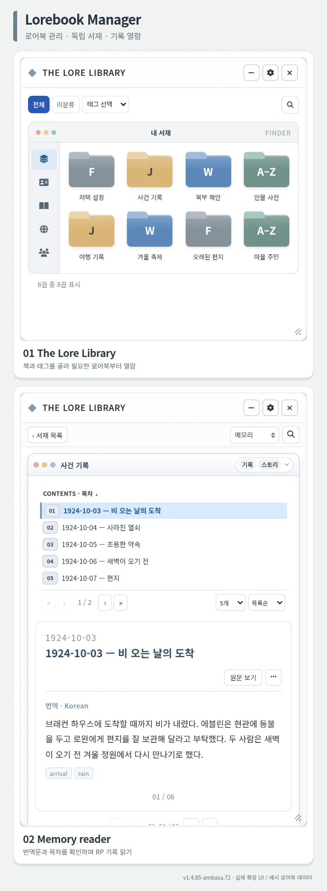
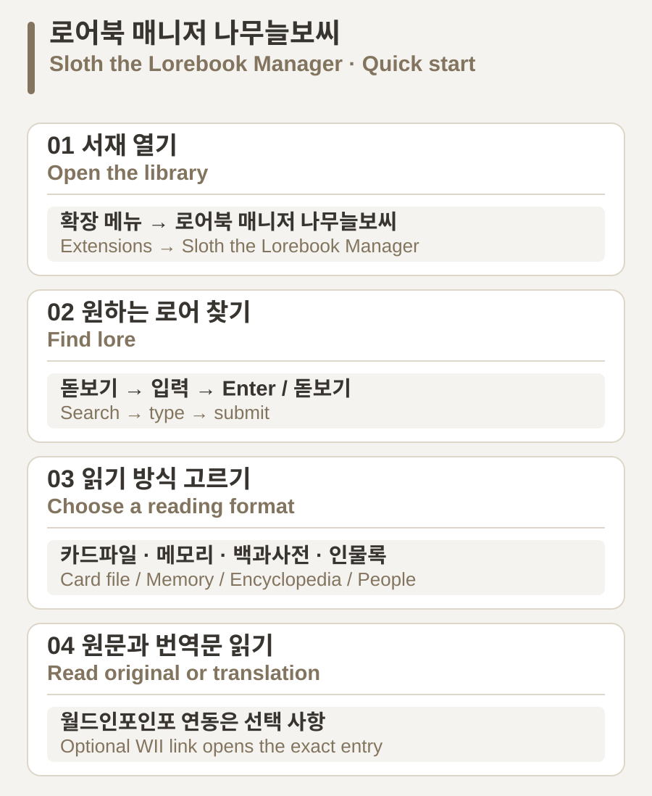
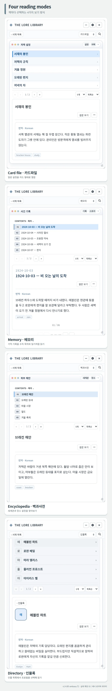
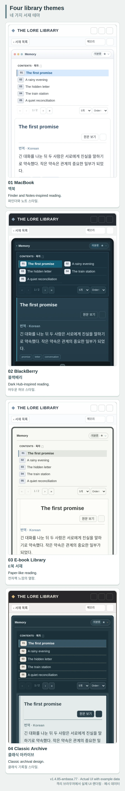
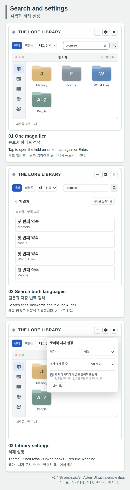
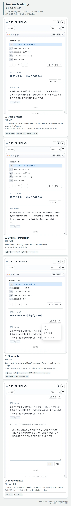

# 📚 Lorebook Manager

A fork of **[Lorebook Manager (로어북 매니저)](https://github.com/foreverharibo-boop/lore-manager)** for SillyTavern, made with the original author's permission.

The original extension provides the foundation for lorebook editing, translation, token statistics and backups. This fork retains that foundation and adds an independent reading library, alternative display modes and changes suited to my own resource-constrained setup.

**Current version:** 1.4.85-ambasa.79 · Based on upstream 1.4.85

[한국어 안내 ↓](#-로어북-매니저) · [Original project](https://github.com/foreverharibo-boop/lore-manager) · [Upstream documentation](docs/UPSTREAM_README.md) · [Fork development notes](AMBASA_FORK_NOTES.md)

**One extension, two ways to use it.** Keep SillyTavern's native editor if you only want the independent library. Use the integrated editor if you also want the original batch-editing and translation tools.

## Start here — Lorebook Manager in five minutes

**Current version: 1.4.85-ambasa.79.** A library for the lorebooks you already have. Open the independent library to find, read and organize entries without changing activation rules. The original integrated editor remains available for translation, batch editing and backups.

**Set up once**

1. Install the fork without resetting your data, then reload. In Extensions settings → 로어북 매니저 select the native display mode if you only want the independent reader.
**Everyday reading (no AI setup needed)**

2. Open the library from the Extensions menu. Choose a book, one of four reading formats and your preferred theme.
3. Tap the shelf magnifier, type a search term, then press Enter or the same magnifier. In-book search only searches that book. Saved translations are searchable; no AI request.
4. Read the original or saved translation. Use the entry … menu to edit, translate or jump to the native editor. Set a translation provider only if you need new translations.

### Works alone, better together

> [!TIP]
Memory opens in Timeline by default; choose continuous full text or the original page reader in the library settings (gear icon). Timeline shows the saved Result when available, otherwise a labeled excerpt. Load more in 5/10/20-record batches; the TOC and search still jump to specific records. No new AI request is made.

> The library works without AI, STLO, or Memory Books. Memory Books memories and other existing lorebooks can be displayed in any reading format. With compatible WorldInfo Info and its optional library link, the exact entry opens by book name and UID. STLO's injection order is independent of library reading order.

[STLO](https://github.com/AmbasaS2/SillyTavern-LorebookOrdering) · [Memory Books / 메모리북](https://github.com/AmbasaS2/SillyTavern-MemoryBooks) · [WorldInfo Info / 월드인포인포](https://github.com/AmbasaS2/SillyTavern-WorldInfoInfo)

The detailed sections below explain optional settings. Compatibility is version-dependent; it does not guarantee every third-party extension or device.

## Who is this for?

- Read existing lorebooks in an independent library without the native editor's many settings, or keep the integrated/Foldy editing view.
- Find books and entries by character, tags, favorites, original or saved translated title, keyword and body text; use covers, reference images and Resume Reading.
- Choose four reading formats and four library themes independently, and move, resize or minimize the library.
- Translate body, title and trigger keywords, edit original and translation separately, and translate multiple books or bulk-edit selected activation fields.
- Inspect total, constant, selective and vectorized token statistics and filter entries by activation type in the integrated editor.
- Create manual or automatic backups, restore into an existing or new lorebook, and export selected or all original books as ZIP.
- Prefer an independent reader on a constrained device or server, without promising a universal speed improvement.

The original editing, translation, token and backup tools are still available. If upstream works well for you, you do not have to switch.

## Installation

1. Back up your SillyTavern data, settings and translations, particularly when switching from the original.
2. Open SillyTavern's extension installer and enter:
   <code>https://github.com/AmbasaS2/lore-manager</code>
3. Reload SillyTavern. Open **Extensions → 로어북 매니저** to configure the extension or use the **로어북 매니저** item in the extension menu to open the library.

Do not run the original and this fork together. When replacing an existing installation, preserve your data and replace only the extension code; do not use data reset or uninstall as a migration method. Based on SillyTavern 1.18; other versions and combinations of third-party extensions may behave differently. The interface currently uses Korean labels.

## First setup: Extension settings

Open **Extensions → 로어북 매니저**. If you only want to read, choose the native editor in Display / advanced and open the library. Configure translation only for new translations, and backup options as needed.

| Settings section (current Korean UI) | What to configure |
|---|---|
| 번역 설정 (Translation) | AI connection profile or Google translation, AI output tokens, connection test, body/title/keyword translation, translation-first display, optional AI instructions, automatic translation and automatic application to the original. |
| 화면 · 고급 설정 (Display / advanced) | Native editor, integrated editor or optional Foldy mode; open the independent library and filter books by the selected character. |
| 통합 화면 표시 옵션 (Integrated editor display) | Show activation icons, token statistics, entry filters and bulk-edit toolbar. |
| 로어북 백업 (Backup) | Automatic/manual browser backups, import/export backups, selected/all original JSONs as ZIP. |
| 데이터 관리 (Data management) | Reset translations, backups or extension data. Do not use reset to migrate from upstream. Back up first. |

**Just want to read your books?** Choose the native World Info screen and open the library from the extension menu. If you read translated lore, choose your translation provider and body translation; leave automatic reflection of edited translations into original text off unless you actually want that change.

During RP, open the library → select a book and entry → read the original or translation → edit only if needed. In the library's own settings, choose the theme, shelf rows and linked-character filter; set each book's reading format inside that book.

## 1. Choose a display mode

Under **화면·고급 설정**, select the display mode that suits your setup.

| Mode | Purpose |
|---|---|
| 실리태번 기본 화면 | Keep the native World Info interface and use the separate library when needed. |
| 로어북 매니저 통합 화면 | Use the integrated editor inherited from the original extension. |
| Foldy 연동 화면 | Use the optional Foldy integration when Foldy is installed. |

The independent library is separate from these choices.

## 2. The Lore Library

Open the library from the extension menu or the settings panel. Search and filter books by tags or show books linked to the current character. If no linked books are found, the linked-only view falls back to all books.

Use the book tag panel to mark favorites; favorited books appear first in the shelf. Open the shelf magnifier to reveal a field on its left, enter a term, then press the same magnifier or Enter. Click outside the search controls or press Escape to dismiss the field. Typing alone does not search; submit with Enter or the same magnifier. Shelf search includes book names and original/saved translated titles, keywords and content (up to 100 entry results, no AI calls). The same submit-only search inside a book searches that book. Resume Reading is available in the shelf settings menu. Native-editor entry jumps respect the current search/filter and sort; clear filters if the entry is hidden. Foldy retains its own page navigation.

Choose a reading format for each book:

| Format | Suggested use |
|---|---|
| Card file (카드파일) | General settings, rules and individual records |
| Memory (메모리) | Chronological memories and RP records: timeline, continuous full-text journal, or page turning |
| Encyclopedia (백과사전) | Worldbuilding, locations and background information |
| Character directory (인물록) | Character profiles and relationships |

These are presentation formats for existing lorebook entries, not new lorebook types in SillyTavern. Changing a format, tag or cover does not change World Info injection settings or generate new memories.

## 3. Themes and window settings

Choose from **MacBook, BlackBerry, E-book Library and Classic Archive**. Each theme has layouts for the four reading formats.

Use the window header to move the library, resize it from the corner, minimize it to a small launcher, or close it. The settings button changes the theme, number of visible shelf rows (1–3) and character-linked filtering. Window dimensions can be remembered separately for wide and narrow screens.

## 4. Read and edit records

- Select a book and entry. Switch between the original text and an available translation.
- Browse 5, 10 or 20 entries per list page. Use the navigation buttons or click the page number to jump; sort by numerical World Info Order ascending/descending (**Order↑ / Order↓**) or by title. This is a reading order only; it does not change the lorebook or its injection settings. Missing/non-numeric Order values follow numeric ones in ascending order; descending reverses the list.
- Collapse the contents list in memory, encyclopedia and character reading views.
- Open the **…** menu to edit, translate, open the corresponding entry in World Info or attach a reference image. Edit translations separately from original records.
- Set tags and book covers to organize the library.

The fork also exposes a book/entry UID bridge for compatible WorldInfo Info integrations. That integration is optional.

## 5. Translation and integrated editing

The original translation editor remains available in the integrated view. Select a separate AI connection profile or Google translation in **번역 설정**. AI revision and keyword recommendations require an AI profile even when Google is the translation provider.

Select body, title or keyword translation, and choose whether to display translations instead of originals. Translated titles and keywords are reading aids; the original trigger keywords remain unchanged. Automatic translation and automatic reflection of edited translations into the original text are separate settings; review these before editing.

Use **로어북 일괄 번역** to select one or more books, translate missing entries or retranslate all selected entries. The running job can be canceled. Eligible short entries can be grouped for AI translation; request counts, time and cost depend on the provider and content.

### Integrated editing: statistics and filters

Open Extensions → 로어북 매니저 → 화면·고급 설정 → 통합 화면 표시 옵션. These controls apply on desktop and mobile: activation-type icons; total, constant, selective and vectorized token statistics plus entry count; all/constant/keyword/vector filters; and the bulk-edit toolbar for selected entries. These are book/editor statistics, not the actual injection total of the latest reply.

### Backup and restore controls

Open 로어북 백업 in extension settings. Use manual backup or optional automatic backups on open/edit. Import/export browser backup JSON, restore a selected backup into the current book (with a pre-restore safety backup), restore into a new book, export an individual snapshot, or delete a stored backup. Export selected/all original books as ZIP separately. Data reset can remove saved translations, local backups or all extension settings/cache without deleting original lorebooks; do not reset to migrate.

## 6. Storage, backup and performance

- Original lorebooks remain in SillyTavern. Library categories, tags and image associations are display metadata.
- **Separate translation storage:** translation text and per-entry language settings have been moved out of `settings.json` into per-lorebook JSON files in SillyTavern's server-side user file storage (`/user/files/`). Only preferences and storage references remain in the extension settings. This avoids repeatedly serializing the entire translation collection whenever settings are saved. Existing records are archived and verified before migration.
- Translation storage location: `<SillyTavern data root>/<user handle>/user/files/` (normally `data/default-user/user/files/`). Book files are named `lore-manager-translation-<book-slug>-<hash>.json`; the index is `lore-manager-translation-index-v1.json`. Legacy settings archives and recovery files, when present, are also saved in this location. Back up these files along with your settings and original lorebooks when moving servers.
- Browser-local backups are separate from server translation storage. Automatic backups are optional (off by default); up to 20 backups are retained across books. Import, export and manual backups are available.
- The original lorebook export tools support downloading selected or all original JSON files as a ZIP. This is not the same as exporting translation backups.
- The fork reuses eligible recently visited native pages (up to two) and avoids some repeated layout and translation lookup work. The independent library loads a selected book on demand and displays paginated lists.

These choices address my own usage pattern; they do not guarantee better performance on every device or server. Some processing happens in the browser, not on the server. Desktop and mobile-width layouts have been checked in isolated Chromium tests; this does not establish compatibility with every actual device or extension combination.

## Troubleshooting

If search seems to do nothing, press Enter or the same magnifier after typing. If an entry jump cannot find its row, clear the native editor's search/filter. For reading only, choose the native display mode and the independent library. Do not reset data to switch versions; back up original books and separate translation JSON files.

## Credits and license

Original project: **로어북 매니저 / Lorebook Manager**  
Original author and copyright: see the preserved [NOTICE](NOTICE).  
Original source: [Lorebook Manager](https://github.com/foreverharibo-boop/lore-manager)

This fork is maintained by AmbasaS2 with the original author's permission. Thank you to the original author for sharing the extension and allowing me to adapt it.

Licensed under **AGPL-3.0-only**. See [LICENSE](LICENSE) and [NOTICE](NOTICE). The original README is preserved in [docs/UPSTREAM_README.md](docs/UPSTREAM_README.md), and changes to this fork are recorded in [AMBASA_FORK_NOTES.md](AMBASA_FORK_NOTES.md). The original author's request to keep public forks accessible is a voluntary request; applicable AGPL obligations remain unchanged.

---

# 📚 로어북 매니저

원작자님의 허락을 받아 **[로어북 매니저](https://github.com/foreverharibo-boop/lore-manager)** 를 제 사용 환경에 맞춰 수정한 포크입니다. 원작의 편집·번역·토큰 계산·백업 기능을 기반으로 독립 서재와 표시 방식, 번역 저장 구조 등을 추가하고 조정했습니다.

**현재 버전:** 1.4.85-ambasa.79 (원작 1.4.85 기반)

**서재에서 읽고, 월드 인포에서 설정하세요.** 서재는 따로 열 수 있으므로 기본 월드 인포를 그대로 사용해도 됩니다. 번역과 일괄 편집까지 필요하면 통합 화면을 선택하세요.

## 먼저 읽어 보세요 · 처음 사용하는 분을 위한 5분 안내

**현재 버전: 1.4.85-ambasa.79.** 지금 가진 로어북을 그대로 읽는 나만의 서재입니다. 독립 서재에서 로어를 찾고 읽고 정리하며 주입 설정을 바꿀 필요가 없습니다. 번역·일괄 편집·백업에는 기존 통합 편집기도 사용할 수 있습니다.

**처음 한 번만 설정하기**

1. 원본과 동시 사용하지 말고 데이터를 보존한 채 포크 설치 후 새로고침합니다. 확장 관리 → 로어북 매니저 → 화면·고급 설정에서 기본 화면을 고르면 독립 서재만 사용할 수 있습니다.
**평소 서재 사용법 (AI 연결 불필요)**

2. 확장 메뉴 → 로어북 매니저 → 원하는 책 선택 → 카드파일·메모리·백과사전·인물록 중 보기 방식과 테마 선택.
3. 서가 돋보기 → 검색어 입력 → Enter 또는 같은 돋보기로 실행. 책 안 검색은 해당 책만 검색하며 저장 번역 검색에도 AI 요청은 없습니다.
4. 원문 또는 번역문을 읽고 … 메뉴에서 수정·번역·기본 월드 인포 이동을 합니다. 새 번역이 필요할 때만 제공자를 설정하세요.

### 단독으로도 충분하고, 함께 쓰면 더 편리합니다

> [!TIP]
메모리는 기본 타임라인에서 시작하며 서재 톱니바퀴 설정의 메모리 보기 방식에서 연속 기록장(전문) 또는 페이지 넘김으로 바꿀 수 있습니다. 타임라인은 저장된 Result(결과), 없으면 표시된 본문 미리보기를 사용합니다. 더 보기로 5/10/20개씩 이어 읽고, 목차와 검색으로 원하는 기록에 바로 이동합니다. 새 AI 호출은 발생하지 않습니다.

> AI나 STLO·메모리북 없이도 서재는 작동합니다. 메모리북이 만든 기억도 다른 로어북처럼 읽습니다. 호환 월드인포인포에서 로어북 서가 연동을 켜면 책 이름과 UID로 정확한 항목을 열 수 있습니다. STLO의 주입 순서와 서재의 읽기 순서는 별개입니다.

[STLO](https://github.com/AmbasaS2/SillyTavern-LorebookOrdering) · [Memory Books / 메모리북](https://github.com/AmbasaS2/SillyTavern-MemoryBooks) · [WorldInfo Info / 월드인포인포](https://github.com/AmbasaS2/SillyTavern-WorldInfoInfo)

아래에서 필요한 설정만 자세히 읽으세요. 지원 버전 기준이며 모든 기기·다른 확장 조합을 보장하는 것은 아닙니다.

## 이런 분들께 추천합니다!

- 복잡한 월드 인포 편집기 대신 독립 서재에서 로어를 읽거나 기존 통합 화면·Foldy를 함께 쓰고 싶은 분
- 캐릭터·태그·즐겨찾기·표지·참고 이미지·이어 읽기로 방대한 로어를 정리하고, 원문과 저장 번역의 제목·키워드·본문을 검색하고 싶은 분
- 카드파일·메모리·백과사전·인물록과 네 가지 서재 테마를 독립적으로 조합하고 창의 크기·위치를 조절하고 싶은 분
- 본문·제목·호출 키워드를 번역하거나 원문과 번역을 따로 수정하고 여러 책을 일괄 번역·편집하고 싶은 분
- 전체·상시 주입·선택 주입·벡터화 토큰과 항목 수를 확인하고 발동 방식에 따라 필터링하고 싶은 분
- 자동·수동 백업, 현재 책 또는 새 책으로 복원, 원본 ZIP 내보내기를 사용하고 싶은 분
- 저사양 서버·기기에서 통합 편집 화면 대신 기본 화면과 독립 서재를 사용하고 싶은 분

원작의 통합 편집, 번역, 토큰 계산, 백업 기능은 유지합니다. 원작을 잘 사용하고 있다면 꼭 포크로 바꿀 필요는 없습니다.

## 설치

1. 기존 로어북과 번역 기록, SillyTavern 설정을 백업합니다.
2. 확장 설치 메뉴에 <code>https://github.com/AmbasaS2/lore-manager</code> 를 입력합니다.
3. 새로고침한 뒤 확장 탭의 **로어북 매니저**에서 설정하거나, 확장 메뉴에서 **로어북 매니저**를 눌러 독립 서재를 엽니다.

원작과 이 포크를 동시에 실행하지 마세요. 기존 설치에서 전환할 때는 데이터를 유지하고 확장 코드만 교체하세요. 삭제·전체 초기화를 전환 방법으로 사용하지 마세요. SillyTavern 1.18 기반이며 다른 버전 및 확장 조합에서는 동작이 다를 수 있습니다.

## 처음 한 번: 확장 관리에서 설정하기

확장 관리 → **로어북 매니저**를 펼쳐 주세요. 서재만 쓰실 분은 화면 · 고급 설정에서 기본 화면을 선택하고 서재를 열면 됩니다. 새 번역·통합 편집·백업 설정은 필요할 때 살펴보세요.

| 설정 영역 | 설정할 수 있는 것 / 추천 사용법 |
|---|---|
| 번역 설정 | AI 전용 연결 프로필 또는 구글 번역(무료), AI 출력 토큰, 연결 테스트, 번역 대상(본문·제목·호출 키워드), 번역본 우선 표시, AI 번역 추가 지시, 자동 번역과 원문 자동 반영을 정합니다. |
| 화면 · 고급 설정 | 기본 화면 / 통합 화면 / Foldy 연동 중 선택, 독립 서재 열기, 선택 캐릭터의 로어북만 표시 설정. |
| 통합 화면 표시 옵션 | 제목 옆 발동 방식 아이콘, 토큰 통계, 항목 필터, 일괄 편집 버튼 표시. |
| 로어북 백업 | 자동·수동 백업, 가져오기, 전체 백업 내보내기, 선택·전체 원본 JSON ZIP 내보내기. |
| 데이터 관리 | 번역본·백업·확장 데이터 초기화. 기존 설치에서 전환할 때 사용하지 마세요. 초기화 전에 백업하세요. |

**서재에서 읽기만 할 분**이라면 실리태번 기본 화면을 선택하고, 영어 로어를 번역할 분이라면 번역 방식과 본문 번역부터 설정하세요. 번역 수정 시 원문 자동 반영은 실제 로어를 함께 바꾸려는 경우에만 켜세요.

### 평소 사용 방법

RP 중 확장 메뉴 → 로어북 매니저 → 원하는 책과 항목 → 원문 또는 번역 읽기 → 필요할 때 수정.

서재 톱니바퀴에서 테마·표시 줄 수·메모리 보기 방식·캐릭터 연결 필터를 정하고, 책 안에서 메모리·인물록·백과사전·카드파일 중 보기 방식을 선택합니다. 호출 키워드와 주입 조건을 관리할 때는 실리태번 상단 월드 인포 화면 또는 통합 화면을 이용하세요.

## 1. 화면 표시 방식

확장 탭 → 로어북 매니저 → **화면·고급 설정**에서 선택합니다.

| 표시 방식 | 설명 |
|---|---|
| 실리태번 기본 화면 | 기본 월드 인포 화면을 유지하고 필요할 때 독립 서재를 사용합니다. |
| 로어북 매니저 통합 화면 | 원작의 통합 편집 화면을 기반으로 로어를 관리합니다. |
| Foldy 연동 화면 | Foldy 설치 환경에서 선택할 수 있는 연동 모드입니다. |

독립 서재는 위 표시 방식과 별도로 열 수 있습니다.

## 2. 독립 서재

확장 메뉴 또는 설정의 **독립 서재 열기**에서 실행합니다. 책을 검색하거나 태그로 필터링할 수 있습니다. 현재 캐릭터에 연결된 로어북만 볼 수도 있으며 연결된 책이 없다면 전체 목록을 표시합니다.

책 태그 패널에서 즐겨찾기를 설정하면 서재 상단에 우선 표시됩니다. 서가 돋보기를 누르면 왼쪽에 같은 줄로 입력창이 나타납니다. 검색어를 입력한 뒤 같은 돋보기 또는 엔터로 검색하며, 바깥을 누르거나 Esc를 누르면 입력창이 닫힙니다. 입력하는 동안 검색하지 않고 엔터 또는 같은 돋보기로 제출할 때만 검색합니다. 서가는 책 이름과 전체 책의 원문·저장된 번역 제목·키워드·본문을 검색하고(항목 결과 최대 100개, AI 호출 없음), 책 내부에서는 같은 방식으로 해당 책만 검색합니다. 이어 읽기는 서가 설정 메뉴에서 사용할 수 있습니다. 원본 편집기 이동은 현재 정렬과 검색·필터를 따르며, 항목이 숨겨져 있다면 필터를 해제해야 합니다. Foldy의 페이지 이동은 Foldy 자체 동작을 유지합니다.

| 보기 방식 | 활용 예시 |
|---|---|
| 카드파일 | 일반 설정, 규칙, 개별 사건 |
| 메모리 | 시간순 기억, RP 기록: 타임라인·연속 기록장·페이지 넘김 |
| 백과사전 | 세계관, 장소, 배경 정보 |
| 인물록 | 캐릭터 소개, 인물 관계 |

기존 로어북을 목적에 맞게 보여 주는 기능입니다. 보기 방식이나 태그를 바꿔도 실제 로어북의 주입 조건은 변경되지 않으며, 기억을 자동 생성하는 기능은 아닙니다.

## 3. 테마와 서재 설정

맥북, 블랙베리, E북 서재, 클래식 아카이브의 네 가지 테마를 선택할 수 있습니다. 각 테마에는 네 가지 보기 방식에 맞춘 화면이 있습니다.

상단을 드래그해 창을 이동하거나 모서리로 크기를 조절할 수 있습니다. 최소화하면 작은 실행 버튼으로 돌아가고, 닫기 버튼으로 종료합니다. 설정에서 테마, 서가 표시 줄 수(1–3줄), 연결된 로어북 필터를 조절합니다. 좁은 화면과 넓은 화면의 창 크기를 별도로 기억합니다.

## 4. 로어 읽기와 수정

- 책과 항목을 선택하고 원문 또는 저장된 번역문을 읽습니다.
- 항목 목록을 5개·10개·20개씩 보고, 페이지 번호를 눌러 원하는 페이지로 이동할 수 있습니다.
- **Order↑ / Order↓**(로어북 항목의 순서값 오름차순·내림차순), **제목↑ / 제목↓**(가나다·ABC·자연수 정렬)를 선택합니다. Order는 표시 순서(displayIndex)가 아닌 로어북의 실제 순서값 기준이며, 서재 표시만 바꾸므로 원본 및 AI 주입 설정은 변경하지 않습니다. Order가 없는 항목은 오름차순에서 뒤에 배치합니다.
- 메모리·백과사전·인물록 열람 화면에서는 목차를 접을 수 있습니다.
- **…** 메뉴에서 수정, 번역, 월드 인포의 해당 로어 열기, 참고 이미지 추가를 할 수 있습니다.
- 책의 표지와 태그로 서재를 정리할 수 있습니다.

호환되는 WorldInfo Info의 로어북 서가 연동 기능으로도 정확한 책과 항목을 열 수 있습니다. 별도 확장 설치는 독립 서재의 필수 조건이 아닙니다.

## 5. 번역과 통합 편집

원작의 통합 번역 편집 기능을 사용할 수 있습니다.

**번역 설정**에서 AI 전용 연결 프로필 또는 구글 번역(무료)을 선택합니다. AI 수정·키워드 추천에는 별도 AI 프로필이 필요합니다.

본문·제목·호출 키워드의 번역 여부, 원문 대신 번역본 표시 여부를 선택할 수 있습니다. 제목·키워드의 읽기용 번역이 실제 호출 키워드를 변경하지는 않습니다.

자동 번역과 원문 자동 반영은 각각 별도로 설정합니다. **항목 열 때 자동 번역**, **원문 변경 시 재번역**, **번역 수정 시 원문 자동 반영**의 상태를 확인한 후 사용하세요.

**로어북 일괄 번역**에서는 여러 책을 선택해 미번역 항목만 번역하거나 전체를 재번역할 수 있습니다. 진행 중에는 취소할 수 있으며, AI 번역에서는 조건에 맞는 짧은 항목을 묶어 처리합니다. 번역 시간과 API 사용량은 모델·본문 길이 등에 따라 달라집니다.

### 통합 화면의 토큰 통계·필터

확장 관리 → 로어북 매니저 → 화면·고급 설정 → 통합 화면 표시 옵션에서 제목 옆 발동 방식 아이콘, 전체·상시 주입·선택 주입·벡터화 토큰 및 항목 수, 전체/상시/키워드/벡터 항목 필터, 일괄 편집 버튼을 켤 수 있습니다. PC·모바일 공통이며 이번 답변의 실제 주입 토큰과는 다른 통계입니다.

### 백업과 복원 사용법

로어북 백업 메뉴에서 수동 또는 선택적 자동 백업, JSON 가져오기·내보내기, 개별 백업의 현재 책 복원 또는 새 책 복원, 개별 내보내기와 삭제를 사용합니다. 현재 책 복원 직전에 안전 백업을 만들며 원본 JSON ZIP 내보내기는 별개입니다. 데이터 초기화는 원본 로어북을 지우지 않지만 저장한 번역·브라우저 백업·확장 설정과 캐시 등을 삭제할 수 있으므로 버전 교체에는 사용하지 마세요.

## 6. 저장과 백업

| 구분 | 저장 및 관리 |
|---|---|
| 원본 로어북 | 기존 SillyTavern 로어북 |
| 번역 기록 | `settings.json`이 아닌 서버 사용자 파일 저장소(`/user/files/`)의 로어북별 JSON 파일, 기존 기록은 검증 및 보관 후 이전 |
| 서재 표시 정보 | 확장의 설정, 태그·분류·이미지 연결 정보 |
| 로어북 백업 | 현재 브라우저에 저장, 전체 로어북 합계 최근 20개 |
| 로어북 원본 내보내기 | 선택한 책 또는 전체 원본 JSON의 ZIP |

**번역 저장소 변경:** 기존에는 번역 기록이 실리태번의 `settings.json` 확장 설정에 함께 저장됐지만, 이 포크에서는 번역문과 항목별 번역 언어 정보를 별도 파일로 분리했습니다. 설정을 저장할 때마다 쌓여 있는 모든 번역 기록을 다시 저장하는 부담을 줄이기 위한 변경입니다. 기존 번역은 별도 보관본을 만들고 새 파일의 내용을 검증한 후 이전합니다.

실제 저장 위치는 서버의 `<실리태번 데이터 경로>/<사용자 계정>/user/files/`입니다. 일반적인 기본 계정은 `data/default-user/user/files/`이며, 브라우저에서 접근하는 경로는 `/user/files/`입니다.

- 로어북별 번역: `lore-manager-translation-<책 이름 기반 식별자>-<해시>.json`
- 번역 색인: `lore-manager-translation-index-v1.json`
- 이전 시 생성된 기존 설정 보관본과 복구 파일도 같은 위치에 저장됩니다(해당 파일이 있는 경우).

서버를 옮길 때는 `settings.json`과 원본 로어북뿐 아니라 이 위치의 `lore-manager-*.json` 번역 관련 파일도 함께 백업해 주세요.

자동 백업은 기본적으로 꺼져 있습니다. 필요할 때 활성화하거나 수동 백업을 사용하세요. 브라우저 백업과 서버 번역 기록, 원본 ZIP은 서로 다른 데이터입니다. 데이터 초기화 전 반드시 필요한 기록을 별도로 백업하세요.

## 7. 원작에서 달라진 부분

| 영역 | 원작을 기반으로 이 포크에서 조정한 부분 |
|---|---|
| 화면 | 기존 통합 편집기 외에 기본 화면·독립 서재를 선택하여 사용 |
| 번역 저장 | `settings.json`에 함께 저장하던 번역 기록을 서버의 별도 사용자 파일 저장소에 로어북별 JSON으로 분리 |
| 번역 작업 | 여러 책을 선택하는 일괄 번역, 조건에 맞는 AI 항목 묶음 처리 |
| 페이지·렌더링 | 최근 방문 페이지 최대 2개 재사용 및 반복 레이아웃·조회 작업 일부 감소 |
| 읽기 | 네 가지 보기 방식, 네 가지 테마, 목차·검색·태그·표지·참고 이미지 |

저사양 환경에서 제가 필요한 화면만 열어 사용하는 방식에 맞춘 변경입니다. 서버 성능뿐 아니라 브라우저 작업량도 영향을 미치므로 모든 환경에서 더 빠르다는 의미는 아닙니다. 격리된 Chromium 환경에서 PC·모바일 폭을 검증했지만 모든 실제 기기 및 확장 조합의 호환성을 보장하지는 않습니다.

## 원작자 및 라이선스

- 원작: **로어북 매니저**
- 원작자 및 저작권: 원작자님 ([NOTICE](NOTICE)의 기존 저작권 고지 참조)
- 원작 저장소: [로어북 매니저](https://github.com/foreverharibo-boop/lore-manager)
- 포크 관리: AmbasaS2

이 확장의 기반을 만들어 공개해 주시고 수정과 공개를 허락해 주신 원작자님께 감사드립니다.

**AGPL-3.0-only** 라이선스를 따릅니다. [LICENSE](LICENSE)와 [NOTICE](NOTICE)를 확인해 주세요. [원작 README](docs/UPSTREAM_README.md)는 원문 그대로 보존했으며, 포크의 수정 이력은 [AMBASA_FORK_NOTES.md](AMBASA_FORK_NOTES.md)에 기록되어 있습니다. 공개 포크 유지에 관한 원작자의 요청은 자발적인 요청이며 AGPL의 의무는 그대로 적용됩니다.

*서재·설정 이미지는 실제 한국어 확장 화면을 예시 데이터로 렌더링한 것이며, 새 5분 안내 이미지는 설명용 구성도입니다. 주요 용어는 한영 병기로 표기합니다.*
